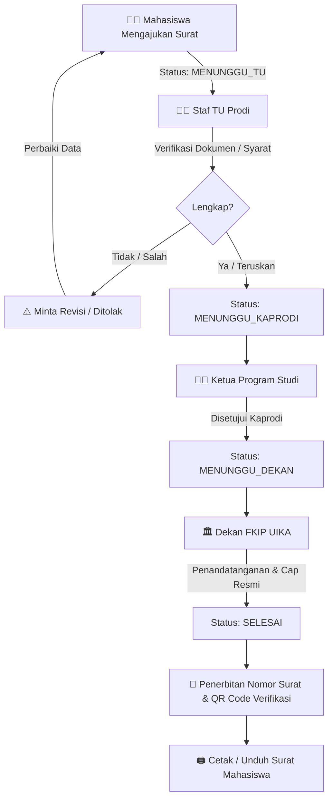

# 🎓 SASMITA — Sistem Administrasi Surat Mahasiswa
### Fakultas Keguruan dan Ilmu Pendidikan (FKIP) — Universitas Ibn Khaldun (UIKA) Bogor

[](https://codeigniter.com/)
[](https://php.net/)
[](https://mysql.com/)
[](LICENSE)

**SASMITA** (*Sistem Administrasi Surat Mahasiswa*) adalah platform persuratan akademik digital terintegrasi yang memfasilitasi mahasiswa dalam mengajukan berbagai permohonan surat akademik, serta memudahkan Staf Tata Usaha, Ketua Program Studi, dan Dekan dalam memverifikasi dan menandatangani surat secara digital.

Aplikasi ini dibangun menggunakan arsitektur **HMVC (Hierarchical Model-View-Controller)** pada **CodeIgniter 4**, menghadirkan performa tinggi, struktur modular yang rapi, keamanan terstandarisasi, dan desain antarmuka modern bernuansa khas UIKA (*Forest Green* `#144218` & *Golden Amber* `#f9a825`).

---

## 🚀 Fitur Unggulan Sistem

- 📄 **7 Jenis Layanan Surat Akademik Lengkap**:
  1. Surat Keterangan Mahasiswa Aktif
  2. Surat Keterangan Tidak Sedang Kuliah (Cuti/Libur)
  3. Surat Izin Penelitian
  4. Surat Permohonan Pengenalan Lapangan Persekolahan (PLP) / Magang
  5. Surat Permohonan Observasi Mata Kuliah
  6. Surat Rekomendasi Akademik
  7. Surat Keterangan Lulus (SKL)
- 📊 **Visual Step Progress Tracker**: Pelacak alur real-time progres surat (Pengajuan ➔ Verifikasi TU ➔ Persetujuan Kaprodi ➔ TTD Dekan ➔ Selesai).
- 🏷️ **Interactive Counter Badges & Floating Hover Toolbar**: Badge numerik ringkas di sidebar yang menampilkan *floating popover* informatif saat kursor diarahkan ke angka.
- ⚡ **Approver Efficiency Hub (Staf TU, Kaprodi, Dekan)**:
  - **Batch Approval (1-Click Persetujuan Massal)**.
  - **Quick Preview Modal (👁️ Intip Berkas)** tanpa keluar dari halaman antrean.
  - **SLA Color Indicators** (🟢 Normal, 🟡 Peringatan, 🔴 Terlambat/Overdue).
  - **Live Search & Filter Kategori**.
- 🔐 **Verifikasi Keaslian & Anti-Pemalsuan Berkas**:
  - Validasi publik digital melalui QR Code unik di cetakan surat (`/verify/{nomor_surat}`).
  - Watermark anti-tamper dinamis & *Scan Audit Logging* (`audit_scan_logs`).
  - Fitur *1-Click Copy Link Verifikasi*.
- 📈 **Ekspor Laporan & Statistik**: Rekapitulasi surat berformat CSV untuk Dekan dan Kaprodi.
- 🛡️ **Pendaftaran Mandiri Mahasiswa Berkeamanan Tinggi**: Hashing kata sandi Bcrypt cost 12, Anti-CSRF token, dan *Honeypot Bot Trap*.
- 📱 **Mobile Bottom Navigation Bar**: Responsif penuh pada perangkat ponsel / smartphone.

---

## 📋 Prasyarat Sistem (Prerequisites)

Pastikan lingkungan server lokal Anda telah memenuhi spesifikasi berikut:

| Komponen | Spesifikasi Minimum | Rekomendasi |
| :--- | :--- | :--- |
| **PHP** | Versi 7.4.x | PHP 8.0 atau 8.1 |
| **Ekstensi PHP** | `intl`, `mbstring`, `mysqli`, `curl`, `json` | Seluruh ekstensi aktif |
| **Database** | MySQL 5.7+ / MariaDB 10.3+ | MySQL 8.0+ |
| **Package Manager** | Composer v2.x | Versi terbaru |
| **Web Server / Tool**| Laragon / XAMPP / Apache / Nginx | Laragon (disarankan) |

---

## 🛠️ Panduan Instalasi Langkah-demi-Langkah

### 1. Masuk ke Direktori Proyek
Buka terminal dan pastikan berada di folder proyek `sasmita-ci4`:
```bash
cd sasmita-ci4
```

### 2. Instalasi Dependensi Composer
Jalankan Composer untuk mengunduh dependensi CodeIgniter 4:
```bash
composer install
```

### 3. Persiapan Database
1. Buka MySQL Client Anda (phpMyAdmin, HeidiSQL, DBeaver, atau MySQL CLI).
2. Buat database baru bernama `surat` (jika belum ada):
   ```sql
   CREATE DATABASE IF NOT EXISTS surat CHARACTER SET utf8mb4 COLLATE utf8mb4_unicode_ci;
   ```
3. Import file database **`sasmita.sql`** (berada di direktori root / sejajar dengan folder `sasmita-ci4`) ke dalam database `surat`.

> [!TIP]
> **Import via Terminal / Command Prompt:**
> ```bash
> mysql -u root -p surat < ../sasmita.sql
> ```

### 4. Konfigurasi Environment (`.env`)
Salin file `env` menjadi `.env` jika belum tersedia:
```bash
copy env .env   # Di Windows (CMD/PowerShell)
# atau
cp env .env     # Di Linux/macOS
```

Buka file `.env` dan sesuaikan pengaturan dasar serta koneksi database:
```ini
#--------------------------------------------------------------------
# ENVIRONMENT
#--------------------------------------------------------------------
CI_ENVIRONMENT = development

#--------------------------------------------------------------------
# APP
#--------------------------------------------------------------------
app.baseURL = "http://localhost:5050"

#--------------------------------------------------------------------
# DATABASE
#--------------------------------------------------------------------
database.default.hostname = localhost
database.default.database = surat
database.default.username = root
database.default.password = 
database.default.DBDriver = MySQLi
database.default.port     = 3306
```

---

## 💻 Menjalankan Aplikasi Secara Lokal

Jalankan server pengembangan bawaan CodeIgniter (*Spark*):

```bash
php spark serve --port 5050
```

Setelah server aktif, buka peramban (*browser*) Anda dan akses:
👉 **`http://localhost:5050`** atau langsung ke halaman login: **`http://localhost:5050/auth/login`**

*(Alternatif: Jika menggunakan Laragon / Apache VirtualHost, arahkan document root virtual host Anda langsung ke subfolder `public/`).*

---

## 🔑 Akun Demo Pengujian (Default Credentials)

Database demo telah dilengkapi dengan akun untuk seluruh tingkatan pengguna dengan kata sandi bawaan yang sama:

> **Kata Sandi Default Semua Akun Demo:** `demo123`

| Role / Jabatan | Alamat Email | Nama Pengguna | Akses Fitur Utama |
| :--- | :--- | :--- | :--- |
| **Mahasiswa** | `ahmad.fauzan@student.uika-bogor.ac.id` | Ahmad Fauzan Ramadhan | Form Pengajuan Surat, Pelacak Alur, Riwayat, Salin Verifikasi |
| **Staf TU Prodi** | `dewi.rahayu@uika-bogor.ac.id` | Dewi Rahayu, S.Pd. | Inbox Verifikasi Berkas, Batch Approve, Kelola Mitra, Filter Status |
| **Kaprodi** | `hendra.gunawan@uika-bogor.ac.id` | Dr. Hendra Gunawan, M.Pd. | Inbox Persetujuan Kaprodi, Riwayat, Statistik Prodi, Ekspor CSV |
| **Dekan** | `mulyadi.santoso@uika-bogor.ac.id` | Prof. Dr. Ir. Mulyadi Santoso | Dashboard Eksekutif, Inbox Penandatanganan (TTD), Laporan Fakultas |
| **Administrator** | `admin@fkip.uika-bogor.ac.id` | Rudi Hartono, S.Kom. | Manajemen Pengguna (CRUD User), Master Tempat Mitra, Laporan Sistem |

> [!NOTE]
> Mahasiswa baru juga dapat langsung mendaftar secara mandiri melalui menu registrasi: `http://localhost:5050/register`.

---

## 🔄 Alur Standar Persuratan Akademik (Workflow)



---

## 📁 Struktur Direktori Proyek

Aplikasi menggunakan arsitektur modular HMVC (*Hierarchical Model-View-Controller*):

```
sasmita-ci4/
├── app/
│   ├── Config/              # Konfigurasi sistem CI4 (Database, Routes, App, Filters, dll.)
│   ├── Controllers/         # BaseController utama
│   ├── Modules/             # Arsitektur Modular HMVC
│   │   ├── Auth/            # Modul Autentikasi (Login, Register Mahasiswa, Logout)
│   │   ├── Mahasiswa/       # Dashboard mahasiswa, 7 form pengajuan surat, riwayat
│   │   ├── StafTU/          # Verifikasi TU, batch approval, kelola tempat mitra
│   │   ├── Kaprodi/         # Persetujuan pimpinan prodi, statistik, ekspor data
│   │   ├── Dekan/           # Pengesahan akhir surat, laporan statistik fakultas
│   │   ├── Admin/           # Master user, master mitra, audit sistem
│   │   ├── Notifikasi/      # Manajemen notifikasi real-time unread
│   │   └── Verifikasi/      # Cetak surat resmi & validasi publik QR Code
│   ├── Services/            # Layanan pendukung (EmailNotificationService, dll.)
│   └── Views/
│       ├── layouts/         # Template utama (main.php, mobile nav, alert floating toolbar)
│       └── partials/        # Komponen terpadu (sidebar_nav.php, status_helpers.php)
├── public/                  # Document root publik web server
│   ├── assets/              # Aset CSS, JS, logo UIKA, favicon
│   └── index.php            # Front controller aplikasi
├── writable/                # Cache, logs, upload session
├── .env                     # File konfigurasi environment aktif
├── composer.json            # Daftar dependensi PHP
└── spark                    # CLI runner CodeIgniter 4
```

---

## 🔒 Catatan Keamanan & Praktik Terbaik Produksi

1. **Document Root**: Pada server produksi (cPanel/VPS/Nginx/Apache), pastikan Document Root web server diarahkan ke direktori **`public/`**, bukan ke direktori root proyek. Hal ini mencegah tereksposnya file `.env` dan kode sumber aplikasi.
2. **Izin Akses Folder (*Permissions*)**: Pastikan direktori `writable/` memiliki izin baca dan tulis (`chmod -R 775 writable/` atau hak akses IIS/Apache).
3. **Environment Mode**: Ubah `CI_ENVIRONMENT = production` pada server live untuk mematikan tampilan pesan debug dan mengaktifkan proteksi ekstra.

---

## 👥 Pengembang & Lisensi

- **Institusi**: Fakultas Keguruan dan Ilmu Pendidikan, Universitas Ibn Khaldun (UIKA) Bogor.
- **Sistem**: SASMITA (Sistem Administrasi Surat Mahasiswa).
- **Lisensi**: Hak Cipta Akademik FKIP UIKA Bogor.
